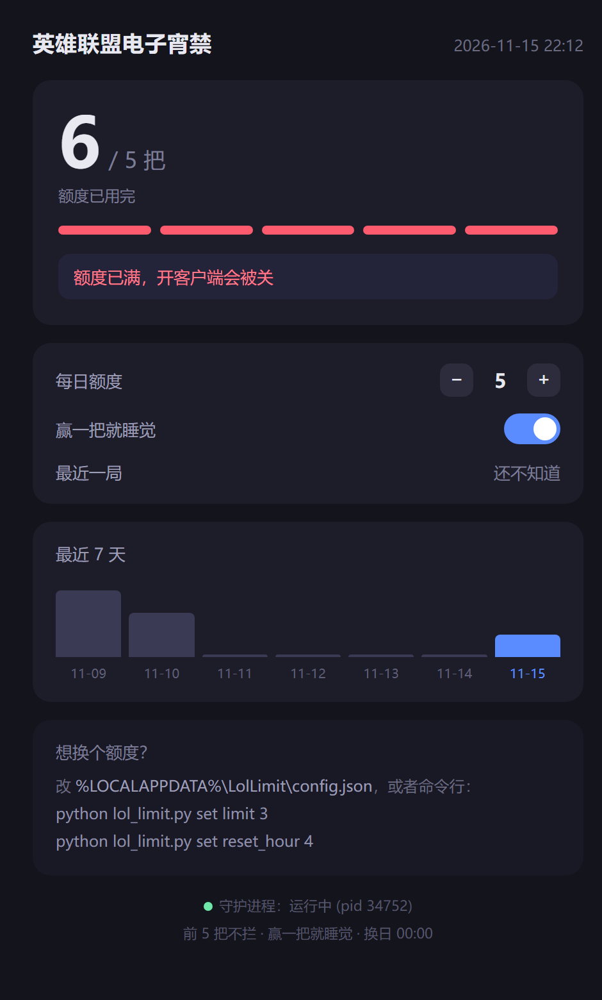

# 英雄联盟电子宵禁



> 给那些**打英雄联盟停不下来**的人。

你是不是也这样：

- 说好"再来一把就睡"，结果打到凌晨三点
- 输了一把不甘心，赢了又觉得手感正热，怎么都停不下来
- 闹钟定过、决心下过、游戏卸载过三次，重装过四次
- 每次都是"这把我 Carry 完就下"，然后 0/12/3，更下不来了

意志力靠不住的时候，就让程序来当坏人。

**电子宵禁不跟你讲道理**：到点就关，输赢说了算。

---

## 它替你做的三件事

### 一、每天前 5 把，随便玩

不多管闲事。上班累了想放松，前 5 把不弹窗、不打扰、不碰你的游戏。

### 二、打满 5 把之后：「赢一把就睡觉」

这是核心规则，也是它最懂你的地方。

打满额度后，每打完一局，它会问你一句"赢了没"：

| 你的回答 | 它做什么 |
|---|---|
| **赢了** | 今天收工，关掉客户端 |
| **输了** | 放行，放你接着打，直到赢一把为止 |

因为你知道的：**输了根本睡不着。** 它不是不让你输，是不让你输着睡。

不想按输赢来？把 `win_to_sleep` 关掉，就是纯"满 5 把直接收工"。

### 三、局内绝不打断

只在你**不在对局**的时候动手。在峡谷里绝对不碰你——免得秒退掉分，还吃排队惩罚。

---

## 它是怎么知道你今天打了几把的

不靠猜，靠客户端自己留的痕迹：

```
D:\WeGameApps\英雄联盟\Game\Logs\GameLogs\
  └─ 2026-11-15T14-55-03\    ← 每进一局必建一个时间戳目录
  └─ 2026-11-15T15-13-43\
  └─ 2026-11-15T16-04-32\
```

数这个目录，就是当天真实的对局数。

再加一路"宵禁自己看见过的游戏进程"做双保险——**就算你把当天的日志目录删了，也清不了零**。

---

## 主要功能

| 功能 | 说明 |
|---|---|
| 每日额度 | 前 N 把随便玩，默认 5，可改 |
| **赢一把就睡觉** | 满额后赢了收工、输了继续，可开关 |
| 局内不打断 | 绝不秒退，不吃排队惩罚 |
| 双路计数 | 日志目录 + 进程记录，删目录也不清零 |
| 自动关客户端 | 满额且不在对局时，局末宽限后关闭 |
| 开机自启 | 登录就在，无窗口、无托盘图标 |
| 改配置立即生效 | 不用重启守护 |
| 没有解锁后门 | 想求情？它只会反问你"今天搞学习了吗" |

---

## 安装

需要 **Windows 10/11** + **Python 3.8 或更高**。

1. 装 Python：<https://www.python.org/downloads/>，安装时**务必勾选 `Add Python to PATH`**
2. 下载本仓库
3. 双击 **`install.bat`**

装好后守护会自动启动，以后每次开机都在。

---

## 界面

双击 `ui.bat`，会弹出一个独立的小窗口（本地页面 + Edge 应用窗口，不用装任何东西）：


- 今天打了几把、还剩几把，一眼看到
- **每日额度自己定**：点 − / + 就能改（发行版最多 5 把），立即生效
- 「赢一把就睡觉」开关，点一下就能切
- **限时封锁和工作日禁打，直接在界面上设置**（两个时段，时间选择器）
- 最近 7 天柱状图，当天那根是蓝的
- 每秒自动刷新，打游戏的时候它就亮在那儿

界面上只读，真正干活的是后台的守护进程；关掉窗口不影响它。

---

## 日常使用

| 双击 | 作用 |
|---|---|
| `ui.bat` | 打开界面 |
| `status.bat` | 命令行看今天打了几把 |
| `install.bat` | 装开机自启 / 修好它 |
| `uninstall.bat` | 卸掉 |

命令行也行：

```bash
python lol_limit.py status
python lol_limit.py config
python lol_limit.py set win_to_sleep off
python lol_limit.py uninstall
```

---

## 配置

`%LOCALAPPDATA%\LolLimit\config.json`（宵禁每秒检查，改了立即生效）：

```json
{
 "limit": 5,
 "max_limit": 5,
 "win_to_sleep": true,
 "workday_block": false,
 "block_ranges": [],
 "grace_seconds": 10,
 "reset_hour": 0,
 "hard_cap": 0,
 "lol_root": ""
}
```

| 键 | 含义 |
|---|---|
| `limit` | 前几把不拦（**发行版锁死最多 5 把**） |
| `max_limit` | 额度硬上限，默认 5；设 0 才不限制 |
| `win_to_sleep` | 「赢一把就睡觉」开关。`false` = 满额直接收工，不问输赢 |
| `workday_block` | 工作日（周一到周五）全天禁打 |
| `block_ranges` | 封锁时段，最多两个，如 `["09:00-12:00", "14:00-18:00"]` |
| `grace_seconds` | 局末给几秒看结算再关 |
| `reset_hour` | 几点换日（熬夜党建议设 4） |
| `hard_cap` | 绝对上限，`0` = 不设限 |
| `lol_root` | 游戏安装目录，留空自动探测 |

> **发行版锁死 5 把**：`max_limit` 默认 5，命令行 `set limit 8` 会被打回 5，
> 界面点 + 到 5 就到头。想更严可以往下调（3 把、2 把），但上不去。
> 这是故意的——工具要是能随便放宽，它就不叫宵禁了。

命令行改也行：

```bash
python lol_limit.py set limit 3
python lol_limit.py set win_to_sleep off
python lol_limit.py set reset_hour 4
python lol_limit.py set block1 09:00-12:00
python lol_limit.py set block2 14:00-18:00
python lol_limit.py set workday_block on
```

---

## 限时封锁 / 工作日禁打

### 最多两个封锁时段

```bash
python lol_limit.py set block1 09:00-12:00
python lol_limit.py set block2 14:00-18:00
python lol_limit.py set block1 off
```

- 到点客户端开着就关（给 10 秒宽限看结算）
- **正在对局中不打断**，让这局打完，之后不让你开新的
- 支持跨午夜，比如 `23:00-02:00`

### 工作日禁打

```bash
python lol_limit.py set workday_block on
```

**按法定工作日算，而且会自动更新**：

- 内置了 2026 年国务院公布的节假日和调休安排（[国办发明电〔2025〕7 号](https://www.gov.cn/zhengce/zhengceku/202511/content_7047091.htm)）作为离线兜底
- 运行时会自动从 [NateScarlet/holiday-cn](https://github.com/NateScarlet/holiday-cn)（社区维护的法定节假日数据）拉取当年 + 次年的安排，缓存在 `%LOCALAPPDATA%\LolLimit\holidays_<年>.json`
- **不用每年手动改代码**：社区每年国务院发文后更新，你这边有网就自动跟上；没网就用缓存或内置表

结果就是：元旦、春节、清明、五一、端午、中秋、国庆自动放行；调休上班的周末（比如 2026 年 2 月 14 日、10 月 10 日）照样封。

---

## 游戏装在哪不用你管

不同人安装路径不一样——D 盘、E 盘、自定义目录都行。程序会自己找，顺序是：

1. 配置里写了 `lol_root` → 直接用
2. **客户端正在运行 → 从进程路径反推**（最准，任何盘符都行）
3. 注册表里的安装信息
4. 各盘符下的常见路径

都找不到也不怕：**你开一次客户端，守护会自动认出路径并记进配置**。

实在不行就手动填：

```json
{"lol_root": "E:\\Games\\英雄联盟"}
```

`status.bat` 最后会打印"游戏目录"，能看到它认的是哪儿。

---

## 赢输怎么判断的

国服客户端的本地接口被反作弊锁死（`lockfile` 恒为 0 字节、进程命令行读不到），
所以没走 LCU，而是**从 WeGame 的战绩界面读**。

WeGame 主界面右侧的「历史战绩」列表，每一行都标着 **胜利（青绿）/ 失败（红）**。
程序截 WeGame 窗口，取第一行结果列的颜色来判断：

| 颜色（文字像素均值） | 判定 |
|---|---|
| 约 RGB(79,190,170) 青绿 | 赢了 |
| 约 RGB(200,65,83) 红 | 输了 |

流程：一局结束 → 等约 25 秒（给 WeGame 同步）→ 截图 → 判色 → 判定。

- **读到了**：直接判定，不打扰你
- **读不到**（WeGame 没开 / 窗口不在 / 没装依赖库）：弹窗问你一句

依赖 `uiautomation` + `Pillow`，装了就全自动，没装就退回弹窗，不影响使用。

```bash
pip install uiautomation pillow
```

---

## 已知限制

不想被问、也不想装依赖的话，把 `win_to_sleep` 关掉就是纯"满额即收工"模式。

---

## 它挡不住什么

- **任务管理器结束守护进程** —— 结束之后当天就不数也不拦了。这是普通用户权限下的极限。
  补救很便宜：双击 `status.bat`，它发现守护没在跑会自动拉起来。
- 直接删掉整个目录。

说白了：**它防的是"手比脑子快"，防不住"铁了心要破戒"。** 但铁了心破戒的时候，你至少得先打开任务管理器，看见那个名字，再点一次结束——这中间的几秒钟，留给你自己重新想想。

---

## 免责声明

- 本项目为**非官方**工具，与腾讯、拳头游戏（Riot Games）无任何关联
- 不修改游戏文件、不读取游戏内存、不注入进程、不访问游戏客户端接口
- 只在本机读取日志目录名、枚举进程、结束进程
- 仅供个人自律使用，使用风险自负

---

## License

[MIT](LICENSE)
